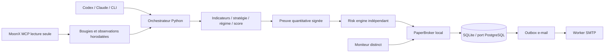

# Architecture effectivement développée

Le noyau ne dépend ni d'un LLM ni de TradingView Desktop. Les interfaces sont des dataclasses immuables et des `Protocol` Python. Les coûts et montants sont des `Decimal`; les statistiques utilisent des flottants sans arrondir les montants d'exécution.

`models`, `config`, `permissions` : contrats et politiques. `indicators`, `analysis`, `fundamentals` : calcul causal. `quantitative`, `backtesting` : recherche. `risk`, `safety` : décisions indépendantes. `paper`, `storage`, `notifications` : cycle transactionnel. `brokers`, `remote_mcp`, `market_data` : ports externes. `orchestrator`, `scheduler`, `mcp_server`, `cli` : coordination.

L'ouverture locale verrouille la ligne compte, relit positions et limites dans la même transaction, déduplique le signal, calcule le risque au prix défavorable, écrit position, frais, événement et outbox avant commit. SQLite utilise `BEGIN IMMEDIATE`; PostgreSQL `SELECT FOR UPDATE` sur le compte. Le worker e-mail utilise une réservation avec bail, un jeton de propriété et `SKIP LOCKED` sur PostgreSQL.

La sérialisation transactionnelle des mutations du compte remplit le rôle de verrou distribué lorsque tous les workers partagent le même PostgreSQL. Deux SQLite indépendants ne coordonnent rien. SQLite sur un système de fichiers réseau n'est pas recommandé. Les ordres distants ne sont pas encore dans ce cycle : ils nécessiteront un état intent/submitted/unknown/reconciled et une réservation avant la requête, sans verrou SQL maintenu pendant l'appel réseau.

Les configurations et la clé d'attestation doivent être montées en lecture seule dans le worker, sous un compte de service différent de l'agent. Le code Python seul ne peut pas empêcher un administrateur ou un agent ayant écriture sur tous les fichiers de modifier ses limites. Aucune isolation OS de production n'est revendiquée par cette livraison.
